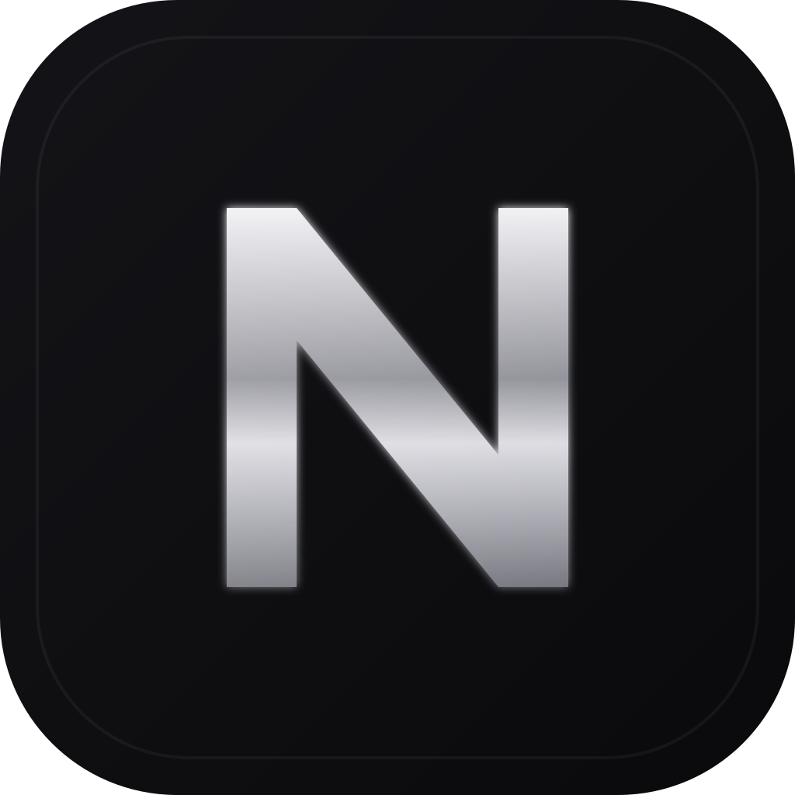
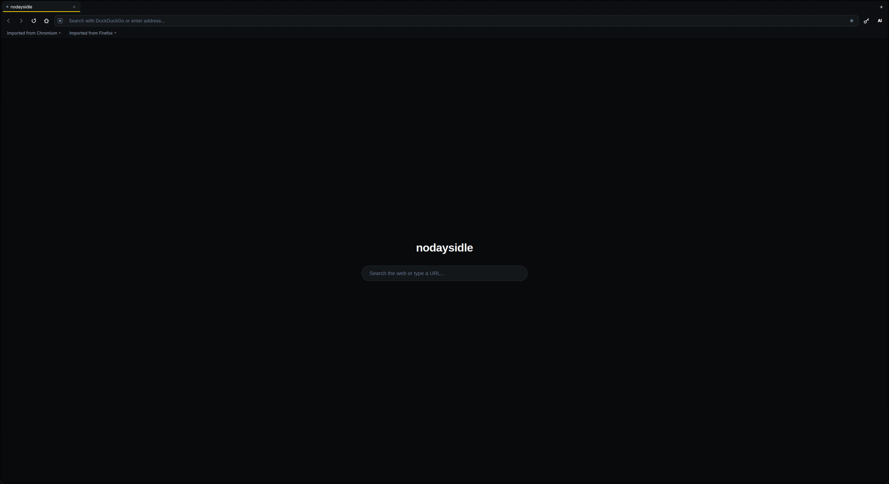
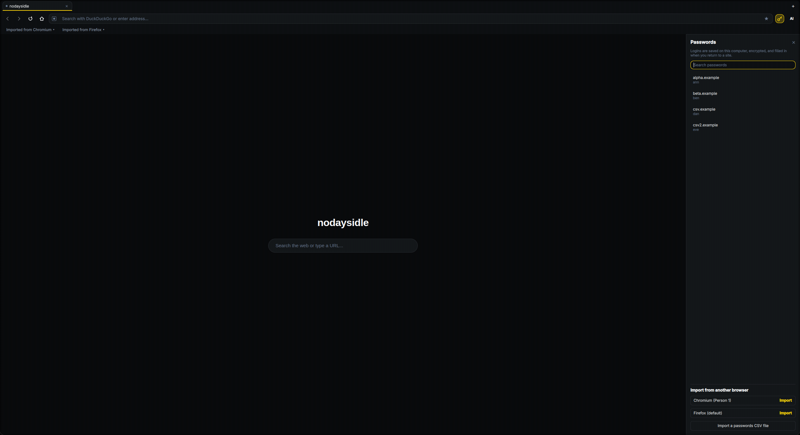

<p align="center">
  
</p>

<h1 align="center">nodaysidle for Linux</h1>



<p align="center">
  <strong>A quiet, native browser for Omarchy (Arch + Wayland + Hyprland).</strong><br>
  Qt 6 Quick on QtWebEngine (Chromium). Minimal chrome, saved passwords that stay on your machine, no telemetry.
</p>

<p align="center">
  
  
  
  
  
</p>

<p align="center">
  <a href="https://github.com/nodaysidle/nodaysidle-browser-linux/releases/download/v0.3.0/nodaysidle-browser-0.3.0-1-x86_64.pkg.tar.zst"><strong>Download Arch package (151 KiB)</strong></a>
  ·
  <a href="https://github.com/nodaysidle/nodaysidle-browser-linux/releases/download/v0.3.0/nodaysidle-browser-0.3.0-linux-x86_64.tar.gz"><strong>Download tarball (154 KiB)</strong></a>
  ·
  <a href="https://github.com/nodaysidle/nodaysidle-browser-linux/releases">All Releases</a>
</p>

<p align="center">
  <a href="#what-it-is">What it is</a> ·
  <a href="#core-capabilities">Features</a> ·
  <a href="#measured-performance">Performance</a> ·
  <a href="#keyboard-shortcuts">Shortcuts</a> ·
  <a href="#installation">Install</a> ·
  <a href="#how-it-works">How it works</a> ·
  <a href="#repository-architecture">Architecture</a>
</p>

---

## What it is

`nodaysidle` is a small browser written for Omarchy. The page is Chromium (through QtWebEngine); everything around it, the tab bar, omnibox, side panels and bars, is Qt Quick drawn with the colors of your current Omarchy theme. It runs as a pure Wayland client and keeps every piece of user data in `~/.local/share/nodaysidle-browser/`.

It is built to be a daily browser, not a demo: Google sign-in works and survives a restart, saved logins fill themselves in, and your bookmarks, history and passwords can be brought over from the browser you used before.



## Core capabilities

**Browsing**
- Tabs with site icons, middle-click close, `Ctrl+Tab` cycling and reopen closed tab
- Omnibox: URL or DuckDuckGo search, local hosts over http, suggestions from bookmarks and history, https indicator, star bookmark
- Find in page with match count, zoom, full screen, print to PDF, downloads to the XDG Downloads folder without overwriting
- Popups for sign-in flows open in their own window and close themselves
- Permission requests (camera, microphone, notifications, clipboard, screen) ask first through a bar; Allow lasts for the session and Deny is never stored. Location requests are refused because QtWebEngine has no location service
- Ad and tracker blocker built in (`src/adblock.h`): requests to a fixed list of ad and analytics hosts are dropped before they leave the machine; your own navigations and a site's own requests are never blocked

**Your data**
- **Passwords:** after a sign-in the browser offers to save, update or never save the login; returning to the site fills it in, including two-step sign-ins that ask for the account first. `Ctrl+Shift+K` lists, shows, copies and deletes logins
- **Import:** bookmarks and history from Chrome, Chromium, Brave, Edge, Vivaldi, Opera, Firefox, Zen, LibreWolf, Floorp and Waterfox profiles; passwords straight from the Chromium family; any browser's passwords CSV export
- **Bookmarks bar** starts empty and shows only what you add or import; each import becomes its own folder
- **History** in a searchable panel (`Ctrl+H`), the last 5,000 visits, stored with mode 0600
- Cookies, cache and site data persist, so you stay signed in

**Omarchy**
- Colors follow `~/.local/state/omarchy/current/theme/colors.toml` live, start page included, and corner radius follows Hyprland's `decoration:rounding`
- Installs as an Arch package, so it shows up in the Omarchy launcher (`Super + Space`)
- A second launch hands its URLs to the running window, so links from other apps open as tabs

**Page assistant** (`Ctrl+Shift+A`): Summarize and free-form questions through Claude Haiku 5.5, and a scam check through TypeSafe Jev. Nothing is sent until you click or press Enter, and a Stop button cancels a stream.

## Measured performance

Reference machine: Intel Core Ultra 7 155H, Intel Arc iGPU, Mesa 26.2.5, 2560x1440 at 165 Hz, Hyprland 0.56.2, QtWebEngine 6.11.2 (Chromium 140). Release build, fresh profile, start page.

| Metric | Result |
|---|---|
| Cold start to a mapped window | 724 ms |
| CPU at idle (10 s, all four processes) | 0.00 % |
| Memory, one tab (proportional, all processes) | 273 MB |
| Page animation, 300 moving sprites | steady 60 fps, no dropped frames |
| Arch package (download) | 151 KiB (154,712 bytes) |
| Tarball (download) | 154 KiB (157,563 bytes) |
| Installed size of the package | 294 KiB |
| Stripped binary | 338 KiB |

The release is small because the engine is not bundled: it uses the Qt and QtWebEngine you already have (`qt6-webengine` is about 283 MiB, shared with other Qt apps). QtWebEngine paces pages at 60 fps even on a faster display; disabling its frame limit removes vsync entirely, so it is left as is.

## Keyboard shortcuts

| Key | Action |
|---|---|
| `Ctrl+T` / `Ctrl+W` | New tab / close tab |
| `Ctrl+Shift+T` | Reopen closed tab |
| `Ctrl+Tab` / `Ctrl+Shift+Tab` | Next / previous tab |
| `Ctrl+L`, `Alt+D`, `F6` | Focus the address bar |
| `Alt+Left` / `Alt+Right` | Back / forward |
| `Ctrl+R`, `F5` / `Ctrl+Shift+R` | Reload / reload ignoring cache |
| `Ctrl+D` / `Ctrl+B` | Bookmark this page / show or hide the bookmarks bar |
| `Ctrl+F`, `Ctrl+G` / `Shift+F3` | Find, next match / previous match |
| `Ctrl++`, `Ctrl+-`, `Ctrl+0` | Zoom in, out, reset |
| `Ctrl+H` | History panel |
| `Ctrl+Shift+K` | Passwords panel |
| `Ctrl+Shift+A` | Page assistant |
| `Ctrl+P` | Save the page as a PDF |
| `F11` / `Esc` | Full screen / leave full screen |
| `Ctrl+Q` | Quit |

## Installation

### Arch package

Download `nodaysidle-browser-0.3.0-1-x86_64.pkg.tar.zst` and `SHA256SUMS` from the [releases page](https://github.com/nodaysidle/nodaysidle-browser-linux/releases), check it, and install:

```sh
sha256sum -c --ignore-missing SHA256SUMS
sudo pacman -U nodaysidle-browser-0.3.0-1-x86_64.pkg.tar.zst
```

It depends on `qt6-base`, `qt6-declarative`, `qt6-webengine`, `qt6-wayland`, `openssl` and `libsecret`. For saved passwords you also need a Secret Service keyring such as `gnome-keyring`. Without one the Passwords panel tells you so and nothing is saved.

### Tarball

The tarball holds the binary, the launcher entry, the icon and fish completions. It needs the same Qt packages as above.

```sh
tar xzf nodaysidle-browser-0.3.0-linux-x86_64.tar.gz
cd nodaysidle-browser-0.3.0-linux-x86_64
install -Dm755 nodaysidle-browser ~/.local/bin/nodaysidle-browser
install -Dm644 com.nodaysidle.Browser.desktop ~/.local/share/applications/com.nodaysidle.Browser.desktop
install -Dm644 nodaysidle-browser.svg ~/.local/share/icons/hicolor/scalable/apps/nodaysidle-browser.svg
```

### Build from source

Needs Qt 6 (`qt6-base`, `qt6-declarative`, `qt6-webengine`, `qt6-wayland`), `openssl` and `libsecret`.

```sh
./bin/build                        # qmake6 + make, writes build/nodaysidle-browser
./bin/run [URL]                    # run it
./bin/install                      # makepkg -fsi: install the package so it shows in the launcher
./scripts/install-desktop.sh       # or install into ~/.local without a package
bash scripts/validate.sh           # build, qmllint, cargo build, fmt, clippy
```

Set it as your default browser with `xdg-settings set default-web-browser com.nodaysidle.Browser.desktop`.

## How it works

- **Platform.** `main.cpp` forces `QT_QPA_PLATFORM=wayland` and starts QtWebEngine with GPU rasterization and zero-copy. `--use-gl=egl` is deliberately not set: it forces GLES2 and crashes the in-process GPU thread on Wayland.
- **Profile.** A named, non-off-the-record profile with its own storage path keeps cookies and site data on disk; the default QtWebEngine profile is off the record and would forget every sign-in.
- **Google sign-in.** Google rejects QtWebEngine ("This browser or app may not be secure"). The profile sends a plain Chrome user agent that matches the engine's major version, and `src/chrome_app.js` defines `window.chrome.app`, which QtWebEngine never provides. Both are needed.
- **Passwords.** A login agent (`src/login.js`) runs in an isolated page world, so page scripts cannot see or forge it. It finds password fields, reports a submitted login and fills a saved one, and speaks to the browser through console lines that carry a random per-run nonce. `Vault` stores the logins in `passwords.vault` encrypted with AES-256-GCM; the key is a random 32 bytes held in the desktop keyring through `secret-tool`, so no readable secret is ever written to disk.
- **Import.** `Importer` reads other browsers' profile folders directly. Their databases are copied first because they are locked while those browsers run. Chromium passwords are decrypted with the Safe Storage key from the keyring; Firefox-family passwords come in through the CSV export, since Firefox keeps them under its own key store.
- **Theme.** `Theme` watches Omarchy's `colors.toml` (re-arming the watcher when a theme switch replaces files) and polls `hyprctl` for the corner radius.
- **Ad blocker.** A `QWebEngineUrlRequestInterceptor` drops sub-resource requests whose host, or a parent domain, is on the list, off the UI thread.
- **Assistant.** The backend streams Anthropic Messages over SSE for Claude Haiku 5.5 and posts to TypeSafe Jev for the scam verdict. Keys come from the environment, then `~/.config/fish/secrets.fish`, then `~/.config/fish/fish_variables`: `ANTHROPIC_API_KEY` or `HAIKU_API_KEY`, and `TYPESAFE_API_KEY`. The app never writes them to disk.

## Languages and size

| Language | Where | Lines |
|---|---|---|
| C++17 | backend, vault, importer, theme, ad blocker, startup | 1,750 |
| QML | window, panels, bars, menus, icons | 1,989 |
| JavaScript | login agent, `window.chrome.app` shim | 161 |
| HTML / CSS | start page | 83 |
| Rust | `src/main.rs`, a 23-line cargo wrapper that starts the Qt binary | 23 |

## Repository architecture

| Path | Role |
|---|---|
| `nodaysidle-browser.pro` | qmake project: Qt modules, sources, `-lcrypto` |
| `src/main.cpp` | Wayland setup, persistent profile, Chrome user agent, downloads, single instance, QML engine |
| `src/backend.{h,cpp}` | Bookmarks, history, URL resolution, clipboard, Anthropic and Jev calls |
| `src/vault.{h,cpp}` | Encrypted saved logins and the keyring-held key |
| `src/importer.{h,cpp}` | Imports from Chromium and Firefox family profiles and passwords CSV |
| `src/theme.{h,cpp}` | Omarchy `colors.toml` watcher and Hyprland rounding |
| `src/adblock.h` | Hardcoded ad and tracker request blocker |
| `src/Main.qml` | Window, tabs, toolbar, find, permission and save-login bars, history and assistant panels |
| `src/PasswordsPanel.qml` | Saved logins and import panel |
| `src/IconButton.qml`, `ThemedMenu*.qml` | Toolbar icons drawn on one grid, themed menus |
| `src/login.js`, `src/chrome_app.js` | Login agent, Google sign-in shim |
| `src/home.html` | Start page |
| `pkgbuild/`, `bin/install` | Arch package for the Omarchy launcher |
| `bin/build`, `bin/run`, `scripts/` | Build, run, validate, per-user install |

## Privacy model

- No analytics, no telemetry, no remote logging
- Passwords are encrypted at rest and the key lives in your keyring; the assistant receives page text only when you ask
- History, bookmarks and the vault are local files under `~/.local/share/nodaysidle-browser/`; history and the vault are mode 0600
- A passwords CSV export is plain text. Delete it after importing

## License

MIT. See [`LICENSE`](LICENSE).
