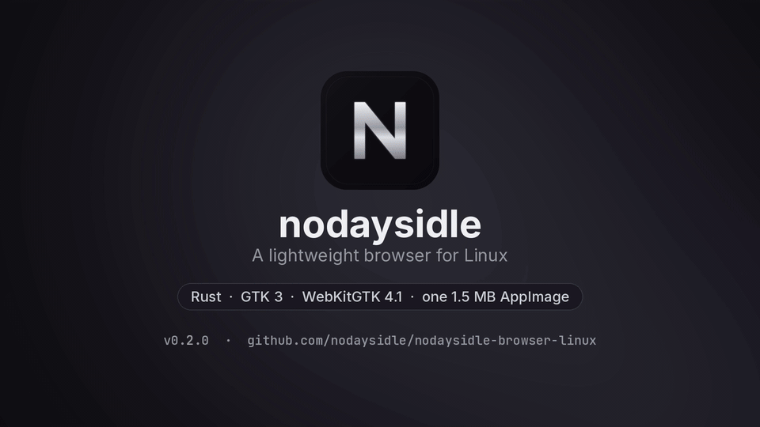

<div align="center">
  

  # nodaysidle (Linux)

  

  **A quiet, native Linux browser for focused browsing.**

  Minimal chrome. Native WebKit pages. Local-first privacy.

  <p>
    <a href="https://github.com/nodaysidle/nodaysidle-browser-linux/releases"></a>
    <a href="https://www.kernel.org/"></a>
    <a href="https://www.rust-lang.org/"></a>
    <a href="https://webkitgtk.org/"></a>
    
  </p>
</div>

`nodaysidle` is a Rust + GTK 3 browser shell that renders pages with WebKitGTK 4.1. It keeps the browser controls close at hand and lets websites own the page, without an Electron runtime, start-page clutter, or application telemetry.

The current release is **v0.2.1**. Everything above the [Unreleased](#unreleased-on-master-not-in-v021) section describes v0.2.1.

macOS version: [nodaysidle-browser](https://github.com/nodaysidle/nodaysidle-browser) (SwiftUI + WKWebView).

## Install

Download the [v0.2.1 bundled AppImage](https://github.com/nodaysidle/nodaysidle-browser-linux/releases/download/v0.2.1/nodaysidle-browser-bundled-x86_64.AppImage) ([all releases](https://github.com/nodaysidle/nodaysidle-browser-linux/releases)). It bundles GTK 3, WebKitGTK 4.1 and their libraries, so they do not need to be installed.

```bash
chmod +x nodaysidle-browser-bundled-x86_64.AppImage
./nodaysidle-browser-bundled-x86_64.AppImage
```

- Size: 91,916,792 bytes (~92 MB)
- SHA-256: `4fa962df7cc6cd405de863289b17436dfae57a8321491a580939f204db31c7a6` ([.sha256](https://github.com/nodaysidle/nodaysidle-browser-linux/releases/download/v0.2.1/nodaysidle-browser-bundled-x86_64.AppImage.sha256))
- Verify: `sha256sum -c nodaysidle-browser-bundled-x86_64.AppImage.sha256` in the download folder

**Older slim AppImage (v0.2.0).** The [v0.2.0 AppImage](https://github.com/nodaysidle/nodaysidle-browser-linux/releases/download/v0.2.0/nodaysidle-browser-x86_64.AppImage) (1,530,360 bytes, ~1.5 MB) contains only the browser binary, desktop file and icon. SHA-256: `02d7a85c3d99f5e395425722c57c46d12fabceccd063554b7f01c2b43229ad93` ([SHA256SUMS](https://github.com/nodaysidle/nodaysidle-browser-linux/releases/download/v0.2.0/SHA256SUMS)). It needs these from the system:

- WebKitGTK 4.1 (`libwebkit2gtk-4.1`, with `libjavascriptcoregtk-4.1` and `libsoup-3.0`)
- GTK 3 (`libgtk-3`, with GLib/GIO, Pango, Cairo, GDK-Pixbuf)

More detail in [docs/APPIMAGE.md](docs/APPIMAGE.md).

## Features

- Native GTK 3 browser chrome backed by WebKitGTK 4.1 (`libsoup3`)
- Search-first Home screen on new tabs, with DuckDuckGo resolution
- Multiple tabs with auto-scrolling active pills
- Multiple windows sharing one profile (cookies, site storage, history)
- Address bar with instant search / URL resolution, HTTPS indicator, load progress, and spoof-resistant URL display
- <kbd>Ctrl</kbd>+<kbd>F</kbd> find bar with match counts and narrow tiling support
- Sized pop-up windows (for example OAuth sign-in) with error and crash pages
- Downloads with folder chooser, progress dialog, cancel protection, and close confirmation
- Bounded local history (`0600`) flushed on exit and signals, and persistent cookies (`0600` SQLite)
- Desktop integration with Wayland `app_id` and X11 `WM_CLASS` (`com.nodaysidle.Browser`)
- No application telemetry

### New in v0.2.1

- **Fully bundled AppImage:** `nodaysidle-browser-bundled-x86_64.AppImage` ships GTK 3, WebKitGTK 4.1 and their libraries, so it runs on systems without them. CI test-runs it in a clean `debian:bookworm-slim` image with no GTK or WebKitGTK installed.

### New in v0.2.0

- **Multiple windows:** `nodaysidle-browser --new-window` (`-n`), <kbd>Ctrl</kbd>+<kbd>N</kbd>, or **New Window** in the ☰ menu. Only closing the last window asks to confirm active downloads.
- **Hyprland corners:** the window frame insets itself to match Hyprland's `decoration:rounding`, read once at startup. The inset is 0 when the window is tiled, maximized or fullscreen. Set `NODAYSIDLE_CORNER_INSET=<px>` to override it.
- **History popover:** sized to fit narrow tiles, with an empty state. The find bar hides on Home and keeps its query.
- **Accessibility:** tabs are exposed as page tabs with names and selected state, close buttons are labelled "Close <title>", and the close icon has higher contrast (about 6:1).
- **Fish completion and desktop action:** the installer adds a fish completion and a **New Window** desktop action.
- **Hardening:** one shared URL display, with lookalike (mixed-script) hostnames kept in punycode and bidi or zero-width characters escaped. Clear Data reports failures in a dialog.
- **AppImage packaging:** the pinned `appimagetool` download is checksum-verified before use, with offline regression tests (`scripts/test-package-appimage.py`).

## Usage

### Keyboard shortcuts

| Action | Shortcut |
| --- | --- |
| New tab | <kbd>Ctrl</kbd>+<kbd>T</kbd> |
| New window | <kbd>Ctrl</kbd>+<kbd>N</kbd> |
| Close tab | <kbd>Ctrl</kbd>+<kbd>W</kbd>, <kbd>Ctrl</kbd>+<kbd>F4</kbd> |
| Next tab | <kbd>Ctrl</kbd>+<kbd>Tab</kbd>, <kbd>Ctrl</kbd>+<kbd>Page Down</kbd>, <kbd>Ctrl</kbd>+<kbd>Shift</kbd>+<kbd>Page Down</kbd> |
| Previous tab | <kbd>Ctrl</kbd>+<kbd>Shift</kbd>+<kbd>Tab</kbd>, <kbd>Ctrl</kbd>+<kbd>Page Up</kbd> |
| Select tab | <kbd>Ctrl</kbd>+<kbd>1</kbd> to <kbd>Ctrl</kbd>+<kbd>8</kbd>, <kbd>Ctrl</kbd>+<kbd>9</kbd> |
| Focus address bar | <kbd>Ctrl</kbd>+<kbd>L</kbd>, <kbd>Alt</kbd>+<kbd>D</kbd>, <kbd>F6</kbd> |
| Reload / stop | <kbd>Ctrl</kbd>+<kbd>R</kbd>, <kbd>F5</kbd> |
| Find in page | <kbd>Ctrl</kbd>+<kbd>F</kbd> |
| Back / forward | <kbd>Alt</kbd>+<kbd>Left</kbd> / <kbd>Alt</kbd>+<kbd>Right</kbd> |
| Full screen | <kbd>F11</kbd> |

In the main window, shortcuts work wherever the focus is, including inside web pages.

### Command line

```bash
nodaysidle-browser [URL-or-file …]
nodaysidle-browser --new-window [URL-or-file …]   # -n
```

An argument naming an existing file (or starting with `./` or `../`) opens that file; anything else is resolved like address bar input (`nodaysidle-browser wikipedia.org` opens `https://wikipedia.org`). Running the command again reuses the existing window unless `--new-window` (`-n`) is given, which opens a new window on the current workspace sharing the same profile.

### Address bar input

- `http://`, `https://`, `file://` and `about:` URLs load as typed.
- `/absolute/path` and `~/path` open local files.
- `localhost`, `*.localhost`, a single-label `host:port`, and local addresses use `http://`: loopback, private IPv4 (`10/8`, `172.16/12`, `192.168/16`), link-local IPv4 (`169.254/16`), IPv6 loopback, unique local (`fc00::/7`) and link-local (`fe80::/10`) addresses. IPv6 literals such as `::1` are bracketed.
- Other input that looks like a domain (`example.com`, `en.wikipedia.org/wiki/Rust`) gets `https://`.
- Everything else is searched with DuckDuckGo, including text with spaces, file names such as `node.js` or `notes.txt`, numbers such as `3.14`, and `javascript:` / `data:` URLs.

URL display is shared by the address bar, pop-up addresses, tab tooltips, fallback host titles, history rows, and error pages. Approved accented Latin labels (`bücher.de`, `café.fr`) and Han-only labels (`例子.测试`) display as Unicode. Other international hosts stay in punycode, including Cyrillic and Greek names that may resemble Latin names. Paths may display readable Unicode, while encoded delimiters, bidi controls and zero-width characters stay escaped. Stored history URLs and navigation destinations stay canonical.

### Pop-up windows

A page script that calls `window.open` with a size (for example an OAuth sign-in) gets a pop-up window; without a size it gets a new tab. A pop-up window shows one page and a read-only address bar:

- <kbd>Ctrl</kbd>+<kbd>W</kbd> or <kbd>Ctrl</kbd>+<kbd>F4</kbd> closes it, <kbd>Ctrl</kbd>+<kbd>R</kbd> or <kbd>F5</kbd> reloads, <kbd>Esc</kbd> closes it unless the page handles the key itself.
- <kbd>Ctrl</kbd>+<kbd>L</kbd>, <kbd>Alt</kbd>+<kbd>D</kbd> or <kbd>F6</kbd> selects the address for copying with <kbd>Ctrl</kbd>+<kbd>C</kbd>; Tab can also focus it.
- Built-in error pages for failed loads and web process recovery.
- No find, no back/forward history, no editable address bar. Pop-ups close with the parent window.

### Clearing browsing data

**Menu → Clear Browsing Data** clears history, cookies and site storage, cached files, and session permission denials independently. A failure dialog reports any selected operation that did not succeed, including website-data failures WebKit reports later. Categories that cleared stay cleared when another one fails.

## Themes

v0.2.1 has one theme, **Dark**: warm charcoal and silver. A light theme (Paper) and a theme menu are [unreleased](#unreleased-on-master-not-in-v021).

## Privacy

- No analytics, telemetry, or application-owned browsing backend. The browser contacts no server except the pages you open.
- Cookies persist locally in `~/.local/share/nodaysidle-browser/webkit-data/cookies.sqlite` (`0600`).
- History is stored in `~/.local/share/nodaysidle-browser/history.json` (`0600`) and flushed atomically on exit or signals (`SIGTERM`, `SIGINT`, `SIGHUP`).
- Web content runs in WebKitGTK's own sandboxed web process; the app does not disable it.
- Location, camera, microphone, notifications and pointer lock need your explicit permission.

## Build from source

Requirements (Arch / Omarchy), plus Rust **1.88** or newer (`rust-version` in `Cargo.toml`):

```bash
sudo pacman -S --needed gtk3 webkit2gtk-4.1 base-devel
```

Run and test:

```bash
git clone https://github.com/nodaysidle/nodaysidle-browser-linux.git
cd nodaysidle-browser-linux
cargo run --release
cargo test --release   # GTK tests run when a display is available
```

Install the launcher and icon:

```bash
./scripts/install-desktop.sh
```

This builds a release binary and installs:

- `~/.local/bin/nodaysidle-browser`
- `${XDG_DATA_HOME:-~/.local/share}/applications/com.nodaysidle.Browser.desktop`
- `${XDG_DATA_HOME:-~/.local/share}/icons/hicolor/scalable/apps/nodaysidle-browser.svg` (plus 48/128/256 px PNGs when `rsvg-convert` is available)
- `${XDG_CONFIG_HOME:-~/.config}/fish/completions/nodaysidle-browser.fish`

Hyprland window rules match `class:^(com\.nodaysidle\.Browser)$`. If an older version installed `nodaysidle-browser.desktop`, the script migrates `mimeapps.list` entries and the default-browser setting to `com.nodaysidle.Browser.desktop` and removes the old launcher.

Build an AppImage:

```bash
./scripts/package-appimage.sh           # slim: dist/nodaysidle-browser-x86_64.AppImage
./scripts/package-appimage-bundled.sh   # bundled with GTK 3 and WebKitGTK 4.1
```

## License

MIT (declared in `Cargo.toml`).

---

## Unreleased (on master, not in v0.2.1)

These changes are in the source but not in any release. The v0.2.1 AppImage does not have them.

### Themes

**Menu → Theme** picks:

- **Match System** (default): follows the desktop's `color-scheme` setting (`org.gnome.desktop.interface`). Without a light preference it stays Dark.
- **Dark:** warm charcoal and silver.
- **Paper:** a warm off-white (`#f3efe6`), never pure white.

The choice applies at once to every window and is saved in the profile's `settings.json`. Dialogs, menus and error pages follow it, and web pages see the matching `prefers-color-scheme`. Every text colour pair meets WCAG AA contrast.

### Ask about this page

<kbd>Ctrl</kbd>+<kbd>Shift</kbd>+<kbd>A</kbd> (or **Menu → Ask About This Page**) opens an optional side panel. It does nothing without your own API keys. Nothing is sent until you click, and only for http(s) pages; local files are never sent.

- **Scam check** asks TypeSafe Jev whether the page impersonates a brand, asks for passwords or card details, or pressures you to act, and shows a verdict with the three estimates. They are estimates and can be wrong. Needs `TYPESAFE_API_KEY`.
- **Summarize** and typed follow-up questions use Claude Haiku 5.5 through the Anthropic API, streamed into the panel, with **Stop**. Needs `ANTHROPIC_API_KEY` (override the model with `NODAYSIDLE_AI_MODEL`).

The panel sends the selection, or the page's main text (up to 12,000 characters), its title, and its address without the query string. Keys are read from the environment and never stored. In fish:

```fish
set -Ux ANTHROPIC_API_KEY 'sk-ant-...'
set -Ux TYPESAFE_API_KEY '...'
# for launches from the desktop launcher rather than a terminal:
systemctl --user set-environment ANTHROPIC_API_KEY=$ANTHROPIC_API_KEY TYPESAFE_API_KEY=$TYPESAFE_API_KEY
```

### Security and privacy

- Links that open a new window become ordinary tabs with no `window.opener`, so the new page cannot redirect the one that opened it.
- A page can open one new window per second; extra requests are blocked and the address bar shows a blocked-pop-up icon.
- Permission prompts explain that embedded sites can only ask when the page allows them. Esc or closing the prompt counts as Deny, which is remembered for that site until you clear it or quit. The browser can quit while a prompt is open.
- Certificate errors get their own "Connection not secure" page, with no way to continue anyway.
- The address never shows `user:password@` (navigation keeps it), and page titles and download names drop invisible and right-to-left override characters. Tag characters in paths stay escaped.
- Clear Browsing Data also removes Cache API storage and old history backups. History, site storage, cached files and denials are ticked by default.
- The temporary profile used when no private profile folder is available is deleted on quit.
- The only servers the browser itself contacts, besides the pages you open, are `api.typesafe.ai` (Scam check) and `api.anthropic.com` (Summarize, questions), and only when you click in the assistant panel.

### Keyboard

| Action | Shortcut |
| --- | --- |
| Reopen closed tab | <kbd>Ctrl</kbd>+<kbd>Shift</kbd>+<kbd>T</kbd> |
| Reload, ignoring cache | <kbd>Ctrl</kbd>+<kbd>Shift</kbd>+<kbd>R</kbd>, <kbd>Ctrl</kbd>+<kbd>F5</kbd> |
| Find next / previous | <kbd>Ctrl</kbd>+<kbd>G</kbd>, <kbd>F3</kbd> / <kbd>Ctrl</kbd>+<kbd>Shift</kbd>+<kbd>G</kbd>, <kbd>Shift</kbd>+<kbd>F3</kbd> |
| Zoom in / out / reset | <kbd>Ctrl</kbd>+<kbd>+</kbd> / <kbd>Ctrl</kbd>+<kbd>-</kbd> / <kbd>Ctrl</kbd>+<kbd>0</kbd> |
| History | <kbd>Ctrl</kbd>+<kbd>H</kbd> |
| Print | <kbd>Ctrl</kbd>+<kbd>P</kbd> |
| Ask about this page | <kbd>Ctrl</kbd>+<kbd>Shift</kbd>+<kbd>A</kbd> |
| Main menu | <kbd>F10</kbd> |
| All shortcuts | <kbd>Ctrl</kbd>+<kbd>?</kbd> |
| Quit | <kbd>Ctrl</kbd>+<kbd>Q</kbd> |

<kbd>Left</kbd> and <kbd>Right</kbd> move between tabs, and middle-click closes one. <kbd>Esc</kbd> in the address bar drops your edit and returns to the page. Reload turns into Stop while a page loads.

### Other changes

- The window title follows the page, a hint sits under the Home search field, the history popover has a search field, and error titles are shorter.
- History is written off the UI thread; the history list, load progress, find-as-you-type and download progress no longer redo work.
- **DMA-BUF renderer off by default.** The browser sets `WEBKIT_DISABLE_DMABUF_RENDERER=1` at startup (`src/main.rs`) to avoid a Mesa/GBM crash on Intel with Wayland. It only does this when the variable is not already set, so you can re-enable the renderer with:

  ```bash
  WEBKIT_DISABLE_DMABUF_RENDERER=0 nodaysidle-browser
  ```
